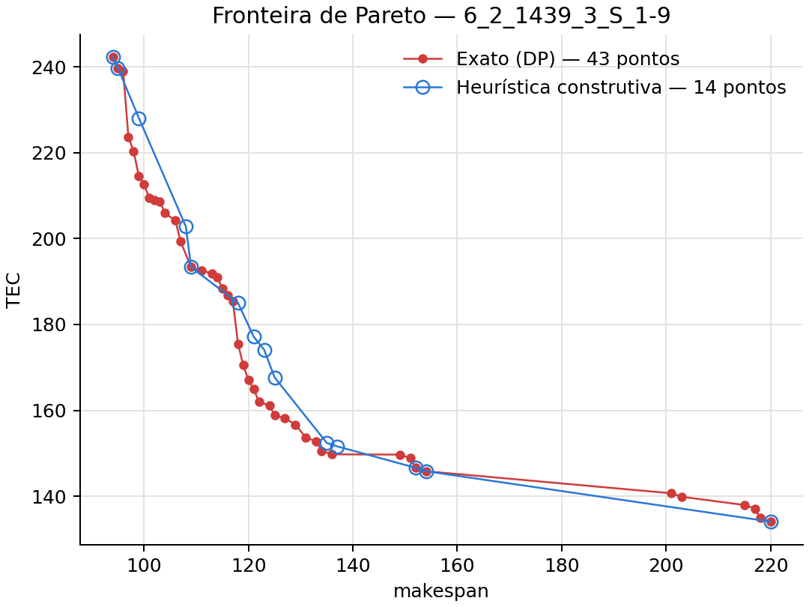

# Heurística construtiva ponderada com ajuste de modos

Esta é uma **heurística**, não uma meta-heurística. Ela não tem população, iterações de busca nem aleatoriedade: constrói soluções com regras gulosas fixas, e a mesma entrada sempre gera a mesma fronteira. Usa só a biblioteca padrão do Python; o matplotlib aparece apenas em `grafico.py`, para desenhar.

## Arquivos

| Arquivo | Conteúdo |
|---|---|
| `construtiva.py` | avaliação por máquina, construção gulosa, ajuste de modos, fronteira, JSON e linha de comando |
| `grafico.py` | fronteira de Pareto da heurística contra a fronteira exata, comparável à Fig. 9A do artigo |
| `tests/test_heuristica_construtiva.py` | 11 testes, na raiz do projeto |

## Como executar

```bash
python src/heuristics/construtiva/construtiva.py data/input/set1/6_2_1439_3_S_1-9.dat   # JSON em data/output/heuristica_construtiva/
python src/heuristics/construtiva/construtiva.py data/input/set1                       # todos os .dat da pasta
python src/heuristics/construtiva/grafico.py                                           # gráfico comparável à Fig. 9A
python -m unittest tests.test_heuristica_construtiva -v
```

## Modelagem

A heurística usa a mesma modelagem do repositório:

- **Entrada e regras:** `read_instance` lê os mesmos arquivos `.dat`, e as regras são as de `problem.py`:
  - não há setup antes da primeira tarefa de cada máquina;
  - a duração é `ceil(p / velocidade)`;
  - a ponta é aplicada por dia;
  - o TEC é calculado em inteiros exatos (`energy_scale`).
- **Formato da solução:** o de `schedule.py`, com as triplas `(tarefa, modo, espera)` de cada máquina. A espera é sempre 0: cada tarefa começa logo depois da anterior e do setup.
- **Validação:** toda solução da fronteira final é conferida por `evaluate_schedule`, o mesmo avaliador dos métodos exatos e das meta-heurísticas.

## Pipeline

```
instância (.dat)
   │
   ├─ 1. Construção gulosa ponderada ── para cada regra LPT (3) e cada α (11)
   │        └─ 33 soluções
   ├─ 2. Ajuste guloso de modos ─────── a partir de cada solução distinta
   │        └─ uma trajetória de soluções por ponto de partida
   ├─ 3. Filtro não dominado ────────── insert_pareto (comparação exata em inteiros)
   ├─ 4. Validação ──────────────────── evaluate_schedule
   └─ 5. Saída ──────────────────────── JSON + gráfico
```

### 1. Construção gulosa ponderada

Esta etapa generaliza o Algoritmo 3 do artigo. O artigo usa duas versões gulosas, uma para cada objetivo; aqui a regra é ponderada por um peso α:

```
para cada tarefa, na ordem da regra LPT:
    para cada máquina, cada modo e cada posição na sequência da máquina:
        se a máquina passaria do horizonte H: descarta
        f = α · Cmax / H  +  (1 − α) · TEC / max_cost      (da solução parcial)
    insere a tarefa na combinação de menor f
```

- **Normalização:** H e `max_cost` vêm da instância e colocam os dois objetivos na mesma escala, como no modelo de soma ponderada do artigo.
- **Desempate:** se duas opções têm o mesmo f, vence a de menor término da máquina, que deixa mais espaço para as próximas tarefas, e depois a de menor TEC.
- **Ordens LPT:** as tarefas entram da mais longa para a mais curta. Com máquinas não relacionadas, o tempo de uma tarefa depende da máquina, então "mais longa" pode ser medido de três formas: soma, mínimo e máximo dos tempos nas máquinas. Nenhuma das três foi a melhor em todas as instâncias testadas, por isso a heurística usa as três.
- **Pesos:** α ∈ {0; 0,1; …; 1}, o conjunto D que o artigo usa no método de soma ponderada (Algoritmo 1). `--pesos` muda a quantidade.

Com α = 1, a construção minimiza o makespan e acaba escolhendo os modos rápidos. Com α = 0, minimiza o custo de energia e escolhe os modos econômicos.

### 2. Ajuste guloso de modos

A soma ponderada só encontra pontos na "casca convexa" da fronteira e deixa buracos entre eles. O ajuste preenche esses buracos. A partir de cada solução construída distinta:

```
repete:
    para cada tarefa e cada outro modo dela:
        economia = TEC atual − TEC com a troca
        aumento  = Cmax com a troca − Cmax atual
        descarta se economia ≤ 0 ou se passar do horizonte
    aplica a troca com maior economia / aumento
        (sem aumento de Cmax, a razão é infinita e tem prioridade)
    registra a nova solução
até nenhuma troca reduzir o TEC
```

Cada passo reduz o TEC em pelo menos uma unidade inteira, então o laço sempre termina. A trajetória vai da solução de partida em direção à região de menor TEC, e cada solução intermediária é um candidato a ponto da fronteira.

### 3 a 5. Fronteira, validação e saída

Todas as soluções das etapas 1 e 2 passam pelo filtro não dominado (`insert_pareto`), que compara (Cmax, TEC) em inteiros exatos. As soluções restantes são revalidadas por `evaluate_schedule` e gravadas em `data/output/heuristica_construtiva/<entrada>.json`, no formato comum do repositório. Cada ponto registra a sua `origem`, por exemplo `lpt_min, alfa=1.00, ajuste 3`.

### Desempenho

Cmax é o maior término entre as máquinas, e TEC é a soma dos custos das máquinas. Por isso, inserir uma tarefa ou trocar um modo só altera a máquina envolvida, e o programa guarda o término e o custo de cada máquina.

Sem espera, inserir uma tarefa ou trocar um modo desloca todo o restante da sequência pelo mesmo `delta`. O custo desse sufixo só muda se ele encostar em uma ponta antes ou depois do deslocamento, e só nesse caso é recalculado. Os slots de ponta saem de um vetor acumulado em O(1). No ajuste de modos, só as trocas da máquina alterada são recalculadas a cada passo.

## Resultado: fronteira de Pareto (comparável à Fig. 9A)

A Fig. 9A do artigo compara a frente de um método aproximado (azul) com a fronteira exata (vermelho) na instância de 6 jobs e 2 máquinas. O gráfico abaixo faz o mesmo na instância `6_2_1439_3_S_1-9`, com a fronteira exata da DP do repositório:



As escalas não são as do artigo, porque o modelo do repositório é diferente: não tem setup inicial, aplica a ponta por dia e usa TEC exato.

**Set1, comparado com a fronteira exata da DP:**

| Instância | Pontos (heurística) | Pontos (exato) | Em comum | Menor Cmax (heur. / exato) | Menor TEC (heur. / exato) | Tempo |
|---|---:|---:|---:|---:|---:|---:|
| `6_2_1439_3_S_1-9` | 14 | 43 | 6 | 94 / 94 | 134,10 / 134,10 | 0,01 s |
| `7_2_1439_3_S_1-9` | 10 | 41 | 2 | 125 / 124 | 146,99 / 146,99 | 0,01 s |
| `8_2_1439_3_S_1-9` | 16 | 57 | 2 | 135 / 131 | 190,71 / 190,71 | 0,02 s |
| `9_2_1439_3_S_1-9` | 19 | 86 | 1 | 157 / 151 | 194,33 / 194,33 | 0,03 s |
| `10_2_1439_3_S_1-9` | 37 | 97 | 0 | 173 / 170 | 185,98 / 185,98 | 0,03 s |

**Leitura dos resultados:**

- **Menor TEC:** a heurística chega ao TEC mínimo exato em todas as instâncias.
- **Menor Cmax:** fica de 0% a 4% acima do ótimo (é exato em 6 jobs).
- **Pontos intermediários:** ficam próximos da fronteira exata, mas raramente sobre ela, e a quantidade de pontos coincidentes cai conforme a instância cresce.

Esse é o comportamento esperado de uma heurística construtiva: rápida e determinística, mas sem a busca que leva uma meta-heurística ou um método exato até a fronteira.

**Tempos em instâncias maiores (set2):** cerca de 1 s com 50 tarefas e 10 máquinas, 17 s com 250 tarefas e 20 máquinas, e 145 s com 750 tarefas e 20 máquinas. Nesta última, a maior parte do tempo vai para o ajuste de modos, com cerca de 12600 passos.

## Limitações

- **Sem espera voluntária:** a heurística nunca atrasa uma tarefa para fugir da ponta. Pontos da fronteira que dependem desse recurso ficam fora do alcance dela.
- **Decisões irrevogáveis:** cada tarefa é inserida uma única vez e não é realocada depois. Só o modo é revisto, na etapa 2.
- **Ajuste só para baixo no TEC:** o ajuste segue a direção de menor TEC a partir de cada ponto de partida. A região de menor Cmax depende das construções com α alto.
- **Sem certificação:** a fronteira é aproximada (`pareto_proven: false`).

## Validação

`tests/test_heuristica_construtiva.py` tem 11 testes. Eles verificam que:

- a sondagem rápida de inserção e a de troca de modo coincidem com o recálculo completo da máquina, inclusive com sequências que atravessam a ponta;
- toda construção (3 regras × α = 0; 0,5; 1) contém cada tarefa uma vez e coincide com `evaluate_schedule`;
- α = 1 dá menor Cmax e α = 0 dá menor TEC;
- a ordem LPT por mínimo está ordenada;
- o ajuste de modos reduz o TEC a cada passo e toda solução da trajetória coincide com `evaluate_schedule`;
- a execução é determinística (33 construções);
- a fronteira é mutuamente não dominada e ordenada;
- nenhum ponto domina a fronteira exata, e os dois extremos exatos são alcançados em `6_2_1439_3_S_1-9`;
- o JSON tem o formato esperado.
