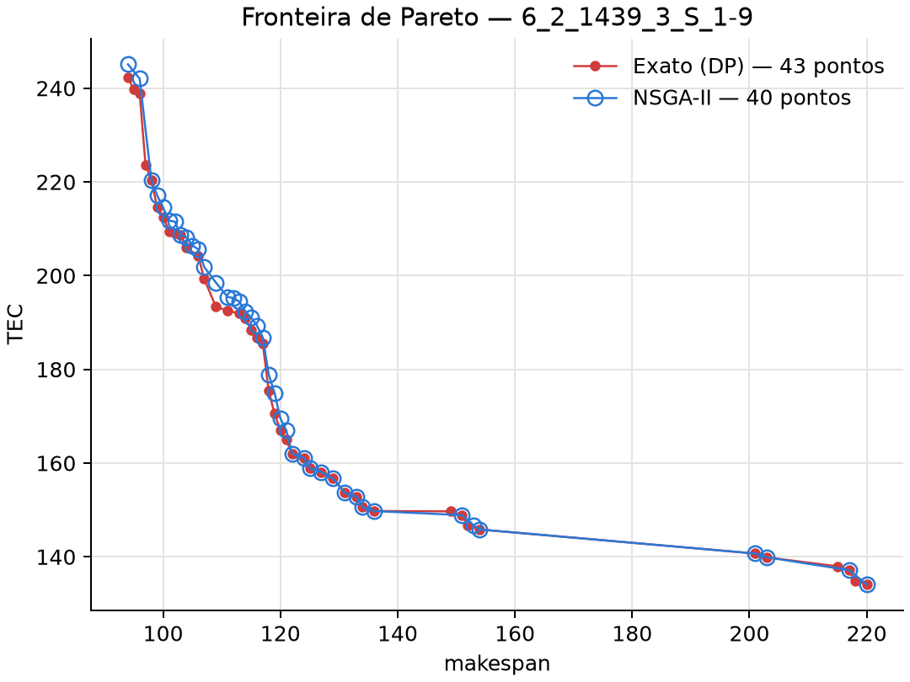

# Heurística: NSGA-II com cromossomo de quatro vetores

Implementação do NSGA-II proposto no artigo base (Rego et al., 2022) para o UPMSP-SDS bi-objetivo:

- minimizar o makespan (`Cmax`);
- minimizar o custo total de energia (`TEC`) com tarifa de ponta/fora de ponta.

O algoritmo usa o `NSGA2` do **pymoo 0.6.2** (ordenação não dominada, crowding distance e torneio binário), com representação, decodificador e operadores próprios.

---

## Arquivos

| Arquivo | Conteúdo |
|---|---|
| `decoder.py` | layout do cromossomo, decodificador e teste com dados fictícios |
| `operators.py` | amostragem inicial, crossover e mutação (classes do pymoo) |
| `nsga2.py` | problema pymoo, execução com orçamento, saída JSON e CLI |
| `plots.py` | gráfico da fronteira de Pareto NSGA-II × exato (Fig. 9A) |
| `tests/test_nsga2.py` | testes unitários (na raiz do projeto) |

---

## Representação

Um indivíduo é um vetor inteiro de tamanho `4N`:

```text
[ seq (N) | machine (N) | mode (N) | avoid (N) ]
```

| Vetor | Domínio | Significado |
|---|---|---|
| `seq` | permutação de `0..N-1` | ordem de inserção das tarefas |
| `machine[k]` | `0..M-1` | máquina da tarefa na posição `k` |
| `mode[k]` | `0..O-1` | modo de operação da tarefa na posição `k` |
| `avoid[k]` | `0/1` | se 1, evita iniciar dentro da ponta |

Os genes de máquina, modo e `avoid` são alinhados à **posição** da sequência, não ao número da tarefa.

---

## Decodificador

Para cada posição `k`, na ordem de `seq`:

1. `duração = ceil(processing / v[modo])`;
2. `início_base = fim_da_máquina + setup(última_tarefa → tarefa)` (sem setup para a primeira tarefa da máquina);
3. se `avoid = 1` e `início_base` cai dentro de uma ponta `[a, b)`, então `início = b`; caso contrário, `início = início_base`;
4. o custo de energia é somado e o fim da máquina e a última tarefa são atualizados.

`Cmax` é o maior término entre as máquinas.

### Custo de energia

O preço de um slot é `π[máquina] · λ[modo] · tarifa · 24 / sizeD`. Para o processamento em `[início, fim)`:

```text
slots_ponta = Σ_dias max(0, min(fim, b) - max(início, a))
custo       = preço_ponta · slots_ponta + preço_fora · (duração - slots_ponta)
```

Os seis casos do artigo (antes da ponta, entra na ponta, dentro, sai, depois, atravessa) correspondem aos valores possíveis dessa interseção. Setup e espera não consomem energia. O TEC é calculado em inteiros exatos (`energy_scale`), sem erro de ponto flutuante.

### Viabilidade

Se alguma tarefa termina após o horizonte, o indivíduo não é descartado: o excesso `Cmax - H` vira a restrição `G` do pymoo, e a dominância com restrições do NSGA-II penaliza esse indivíduo.

---

## Operadores

| Etapa | Sequência (`seq`) | `machine` / `mode` | `avoid` |
|---|---|---|---|
| Crossover | PMX | uniforme | uniforme |
| Mutação | swap de duas posições | reset aleatório (prob. 1/N por gene) | bit-flip (prob. 1/N) |

**População inicial:** dois indivíduos gulosos (Algoritmo 3 do artigo: ordem aleatória, cada tarefa na máquina de menor término) e os demais aleatórios:

- um indivíduo guloso usa sempre o modo mais rápido (foco em `Cmax`);
- o outro usa o modo de menor fator de potência (foco em `TEC`).

---

## Orçamento e saída

- Cada indivíduo avaliado consome uma unidade, inclusive os inviáveis.
- O último lote de descendentes é truncado para respeitar exatamente `--max-evaluations`.
- Ao final, cada sobrevivente viável é revalidado por `evaluate_schedule`. Essas chamadas aparecem como `post_search_validations` e não contam no orçamento.
- A saída fica em `data/output/nsga2/<entrada>.json`, no mesmo formato das outras meta-heurísticas, e cada ponto traz também o `chromosome`. Um resultado existente só é substituído com `--overwrite`.

---

## Diferenças em relação ao enunciado original

Para manter os resultados comparáveis aos métodos exatos e baselines do repositório:

- **não há setup inicial**: as entradas têm setup `M × N × N`;
- há **um horário de ponta por dia** (`peak_start`/`peak_end` por dia), e não um único intervalo;
- os índices começam em 0, e não em 1;
- o TEC é exato (fração), e não `float`.

---

## Como executar

Na raiz do projeto:

```bash
python src/heuristics/nsga2/decoder.py      # teste do decodificador com dados fictícios
python src/heuristics/nsga2/nsga2.py data/input/set1/6_2_1439_3_S_1-9.dat \
    --seed 1 --max-evaluations 2000 --population-size 50
python -m unittest tests.test_nsga2 -v
```

| Parâmetro | Padrão |
|---|---|
| `--seed` | 1 |
| `--max-evaluations` | 10000 |
| `--population-size` | 100 |
| `--crossover-probability` | 0.9 |
| `--mutation-probability` | 0.3 |

Os parâmetros não foram ajustados por experimentos piloto.

---

## Pipeline completo de execução

O fluxo abaixo descreve o que acontece desde o comando até o arquivo de resultado. Os números entre parênteses são da execução de exemplo (`6_2_1439_3_S_1-9`, seed 1, população 50, 2000 avaliações).

```text
 python nsga2.py <entrada.dat> --seed --max-evaluations --population-size ...
        │
 [1] CLI (main)                 lê argumentos, valida NSGA2Config, lista as entradas
        │
 [2] read_instance              .dat ──► Instance (n, m, modos, ponta, π, λ, p, setup)
        │
 [3] Preparação                 ChromosomeProblem (4N variáveis, 2 objetivos, 1 restrição)
        │                       Decoder pré-calcula os preços inteiros (energy_scale)
        │                       NSGA2 do pymoo com os operadores próprios; setup(seed)
        │
 [4] População inicial          2 gulosos (Cmax, TEC) + P-2 aleatórios ─► avaliação
        │
        ▼
 ┌──► [5] ask()                 torneio binário ─► crossover ─► mutação ─► sem duplicatas
 │          │
 │    [6] Truncamento           corta o lote ao orçamento restante
 │          │
 │    [7] Avaliação             decodifica cada filho ─► F = (Cmax, TEC), G = overflow
 │          │
 │    [8] tell()                pais ∪ filhos ─► ordenação não dominada + crowding ─► P
 │          │
 └── orçamento restante > 0 ?
            │ não
 [9] Frente final               viáveis da população ─► evaluate_schedule ─► filtro Pareto
            │
 [10] Saída                     data/output/nsga2/<entrada>.json + resumo no terminal
```

### 1. Linha de comando

`main()` lê a entrada (um `.dat` ou uma pasta de `.dat`) e os parâmetros. `NSGA2Config` rejeita configurações inválidas, como orçamento menor que a população ou probabilidades fora de `[0, 1]`. Se o JSON de saída já existe e não há `--overwrite`, a execução para antes de gastar tempo.

### 2. Leitura da instância

`read_instance` (`src/problem.py`) converte o `.dat` em um `Instance` imutável:

- dimensões `n`, `m`, `o` e horizonte `H = n_day · (hl + 1)` (1440 no exemplo);
- tarifas, horário de ponta por dia como `[peak_start, peak_end + 1)`;
- `v`, `λ`, `π`, `processing[job][máquina]` e `setup[máquina][anterior][próxima]`.

Também calcula o hash SHA-256 do arquivo, gravado no resultado para rastreabilidade.

### 3. Preparação

- `ChromosomeProblem` declara `4N` variáveis inteiras com limites (`upper_bounds`), 2 objetivos e 1 restrição.
- O `Decoder` chama `energy_scale` uma única vez: os preços de ponta e fora de ponta de cada (máquina, modo) viram inteiros sobre um denominador comum (`cost_scale` = 60.000.000 no exemplo).
- O `NSGA2` do pymoo é montado com `ChromosomeSampling`, `MixedCrossover` e `MixedMutation`, eliminação de duplicatas ativa, e inicializado com a seed (que torna a execução reprodutível).

### 4. População inicial

O primeiro `ask()` chama `ChromosomeSampling`:

1. indivíduo guloso para `Cmax`: ordem aleatória, cada tarefa na máquina de menor término, sempre no modo mais rápido;
2. indivíduo guloso para `TEC`: mesmo procedimento, no modo de menor `λ`;
3. `P - 2` indivíduos aleatórios (permutação, máquina, modo e `avoid` uniformes).

Os `P` indivíduos são avaliados (passo 7) e entregues ao algoritmo com `tell()`, consumindo `P` avaliações (50).

### 5. Geração de descendentes: `ask()`

O pymoo produz `P` filhos:

- **seleção**: torneio binário. Vence o indivíduo com menor violação de restrição; entre viáveis, o dominante; se ninguém domina, o de maior crowding distance;
- **crossover** (prob. 0,9 por par): PMX em `seq` e máscara uniforme em `machine`, `mode` e `avoid`, gerando 2 filhos por par;
- **mutação** (prob. 0,3 por filho): swap em `seq`, reset aleatório em `machine`/`mode` e bit-flip em `avoid`, cada gene com prob. `1/N`;
- **duplicatas**: filhos iguais a outro filho ou a um indivíduo da população são descartados e regenerados.

### 6. Truncamento do lote

Se o lote tem mais filhos que o orçamento restante, só os primeiros são mantidos. Assim, o total de avaliações é exatamente `--max-evaluations` (2000 = 50 iniciais + 39 gerações de 50, num total de 40 chamadas a `tell()`).

### 7. Avaliação de um indivíduo

`ChromosomeProblem._evaluate` chama `Decoder.decode`:

1. separa o vetor em `seq`, `machine`, `mode` e `avoid`;
2. percorre as posições inserindo cada tarefa no fim da máquina indicada (setup, regra `avoid`, custo de energia; ver [Decodificador](#decodificador));
3. retorna `F = [Cmax, TEC]` e `G = [max(0, Cmax - H)]`, contando a avaliação como viável ou inviável.

### 8. Sobrevivência: `tell()`

Os filhos avaliados são unidos aos pais (`2P` indivíduos). `RankAndCrowding` separa essa união em frentes não dominadas (com os inviáveis ordenados pela violação, depois de todos os viáveis), preenche a nova população frente a frente e desempata a última frente pela crowding distance. O laço volta ao passo 5 enquanto houver orçamento.

### 9. Frente final

Com o orçamento esgotado:

1. cada indivíduo viável da população final é decodificado de novo;
2. o schedule é **revalidado por `evaluate_schedule`** (`src/schedule.py`), que verifica permutação, sobreposição, setups e horizonte e recalcula `Cmax` e TEC. Se o resultado diferir do decodificador, a execução falha;
3. `insert_pareto` remove dominados e pontos repetidos usando os objetivos exatos `(Cmax, tec_units)`.

Essas revalidações (50 no exemplo) aparecem como `post_search_validations` e não contam no orçamento. A frente do exemplo ficou com 26 pontos.

### 10. Saída

`write_result` grava o JSON de forma atômica (`atomic_json`) em `data/output/nsga2/<entrada>.json`:

```text
algorithm, method, instance, instance_sha256, horizon, cost_scale
run_parameters      seed, orçamento, população, probabilidades
evaluations         avaliações gastas (= budget)
feasible_evaluations / rejected_evaluations
generations, post_search_validations, elapsed_seconds, points
front[]             um item por ponto não dominado
```

Cada ponto da frente contém:

- `makespan`, `tec` (float) e `tec_exact` (numerador/denominador);
- `normalized_makespan` e `normalized_tec` (`Cmax/H` e `TEC/max_cost`);
- `schedule`: para cada tarefa, máquina, modo, início e fim;
- `representation`: sequência por máquina `(job, modo, espera)`;
- `chromosome`: os 4N genes que geraram o ponto.

O terminal mostra o resumo:

```text
6_2_1439_3_S_1-9.dat: avaliações=2000, viáveis=2000, inviáveis=0, gerações=40,
pontos=26, tempo=0.435s, saída=data/output/nsga2/6_2_1439_3_S_1-9.json
```

### Exemplo: do cromossomo ao ponto da frente

Ponto de menor makespan da execução de exemplo:

```text
seq     = [2, 0, 3, 4, 1, 5]
machine = [1, 0, 1, 0, 0, 0]
mode    = [1, 2, 2, 2, 0, 0]      velocidades: modo 0 = 1,2 · modo 1 = 1 · modo 2 = 0,8
avoid   = [0, 0, 0, 1, 0, 0]
```

| k | job | máq. | modo | duração | setup | início | fim |
|---:|---:|---:|---:|---|---:|---:|---:|
| 0 | 2 | 1 | 1 | ⌈88/1⌉ = 88 | 0 (primeira) | 0 | 88 |
| 1 | 0 | 0 | 2 | ⌈12/0,8⌉ = 15 | 0 (primeira) | 0 | 15 |
| 2 | 3 | 1 | 2 | ⌈8/0,8⌉ = 10 | 2 | 90 | 100 |
| 3 | 4 | 0 | 2 | ⌈5/0,8⌉ = 7 | 2 | 17 | 24 |
| 4 | 1 | 0 | 0 | ⌈34/1,2⌉ = 29 | 4 | 28 | 57 |
| 5 | 5 | 0 | 0 | ⌈50/1,2⌉ = 42 | 2 | 59 | 101 |

- Na posição 3, `avoid = 1`, mas o início 17 está fora da ponta `[1080, 1260)`; por isso não há espera.
- Nenhuma tarefa toca a ponta, então todo o custo usa a tarifa fora de ponta.
- Resultado: `Cmax = 101` e `TEC = 215,28`.

Representação resultante:

```text
máquina 0: (0, 2, 0) → (4, 2, 0) → (1, 0, 0) → (5, 0, 0)
máquina 1: (2, 1, 0) → (3, 2, 0)
```

A frente completa vai de `(Cmax 101, TEC 215,28)` até `(Cmax 220, TEC 134,10)`. Esse último é o ponto de menor TEC da fronteira exata da DP, alcançado pela heurística. Nenhum dos 26 pontos domina a fronteira exata.

---

## Validação

Testes unitários (`tests/test_nsga2.py`, 10 testes):

- o decodificador coincide com `evaluate_schedule` em 300 cromossomos aleatórios;
- a regra `avoid` adia o início só quando ele cai na ponta;
- o overflow é reportado sem exceção;
- PMX, crossover e mutação preservam a permutação e os limites;
- o orçamento é respeitado com exatidão;
- nenhum ponto domina a fronteira exata da DP (`6_2_1439_3_S_1-9`).

Execuções de teste (seed 1, população 50):

| Instância | Avaliações | Pontos na frente | Tempo |
|---|---:|---:|---:|
| `6_2_1439_3_S_1-9` | 2000 | 26 | 0,4 s |
| `250_10_1439_5_S_1-9` | 2000 | 8 | 5,5 s |
| `750_10_1439_5_S_1-9` | 1000 | 2 | 8,5 s |

- **6 jobs:** a frente alcançou o ponto de menor TEC da fronteira exata.
- **750_10:** é a instância em que o VNS/VND falhava na inicialização; os indivíduos gulosos garantem soluções viáveis.

---

## Fronteira de Pareto (comparável à Fig. 9A do artigo)

A Fig. 9A do artigo compara uma execução do NSGA-II (azul) com a fronteira do método exato (vermelho) na instância de 6 jobs e 2 máquinas. O gráfico abaixo reproduz essa comparação na mesma instância, `6_2_1439_3_S_1-9`, usando a fronteira exata da DP do repositório:

```bash
python src/heuristics/nsga2/plots.py    # seed 1, 10000 avaliações, população 100 (~2 s)
```



Resultado: o NSGA-II encontra 40 pontos, contra 43 da fronteira exata. 17 desses pontos coincidem com ela, nenhum a domina e os dois extremos de TEC são alcançados.

As escalas não são iguais às do artigo, porque o modelo do repositório é diferente: não tem setup inicial, aplica a ponta por dia e calcula o TEC exato. Por isso a fronteira exata tem 43 pontos aqui, e não os poucos da Fig. 9A. O que se compara é o formato: quanto a heurística se aproxima da fronteira exata e quanto da amplitude ela cobre.
