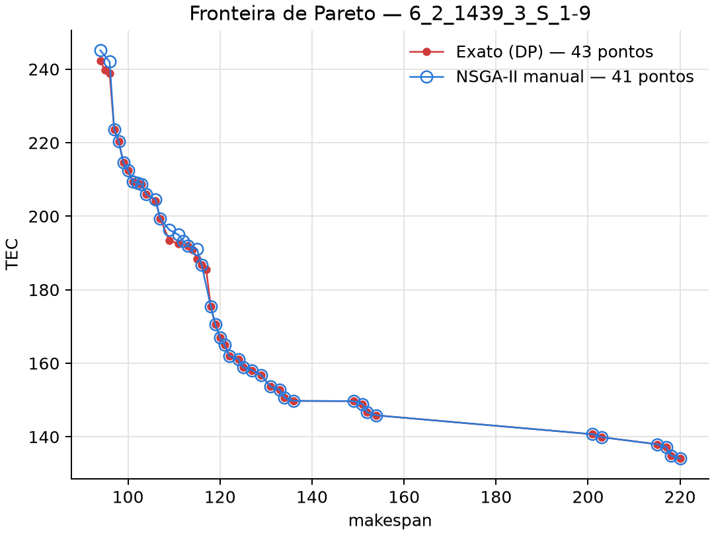

# NSGA-II manual (sem pymoo)

Esta é uma implementação do NSGA-II do artigo base (Rego et al., 2022) escrita do zero. A busca usa só a biblioteca padrão do Python (`random`, `math`, `time`): sem pymoo e sem numpy. O matplotlib aparece apenas em `grafico.py`, para desenhar o resultado.

Ela segue o artigo mais de perto que a versão com pymoo (`src/heuristics/nsga2/`), em três pontos:

- **Representação:** é direta, e não um cromossomo de quatro vetores.
- **Operadores:** são os do artigo: One Point Order Crossover, swap, inserção e troca de modo.
- **Critério de parada:** é o tempo do artigo.

## Arquivos

| Arquivo | Conteúdo |
|---|---|
| `avaliacao.py` | representação, cálculo de Cmax e TEC por máquina e sondagem rápida de inserções |
| `operadores.py` | população inicial (gulosa + aleatória), cruzamento e as três mutações |
| `nsga2_manual.py` | dominância, ordenação não dominada, crowding distance, torneio, laço principal, JSON e linha de comando |
| `grafico.py` | fronteira de Pareto contra a fronteira exata, comparável à Fig. 9A do artigo |
| `tests/test_nsga2_manual.py` | 8 testes, na raiz do projeto |

## Como executar

```bash
python src/heuristics/nsga2_manual/nsga2_manual.py data/input/set1/6_2_1439_3_S_1-9.dat   # JSON em data/output/nsga2_manual/
python src/heuristics/nsga2_manual/grafico.py                                            # figura comparável à Fig. 9A
python src/heuristics/nsga2_manual/nsga2_manual.py <entrada> --geracoes 200 --seed 3     # execução reproduzível
python -m unittest tests.test_nsga2_manual -v
```

## Representação

Cada indivíduo é uma lista por máquina de genes `(tarefa, modo)`, na ordem de processamento, como na Fig. 3 do artigo:

```
máquina 0: (1,0) (4,1) (2,0)
máquina 1: (3,0) (5,0) (0,2)
```

Não há espera: cada tarefa começa logo após o término da anterior mais o setup. As regras do modelo são as de `problem.py`:

- sem setup antes da primeira tarefa;
- duração `ceil(p / velocidade)`;
- TEC em inteiros exatos;
- inviável se o término passar do horizonte.

Cmax é o maior término entre as máquinas, e TEC é a soma dos custos das máquinas. Por isso o indivíduo guarda o término e o custo de cada máquina, e qualquer alteração só recalcula a máquina afetada.

### Custo de energia

O custo de uma tarefa em `[início, fim)` é `on · slots_na_ponta + off · slots_fora_da_ponta`, com os preços inteiros de `energy_scale`. Os slots de ponta saem em O(1) de um vetor acumulado, em que `acumulado[t]` é o número de slots de ponta em `[0, t)`.

### Sondagem de inserção

Sem espera, inserir uma tarefa na posição `p` desloca todo o sufixo pelo mesmo `delta`. O novo término da máquina é `fim_antigo + delta`. O custo do sufixo só muda se ele encostar em uma ponta antes ou depois do deslocamento, e só nesse caso é recalculado. Assim, testar todas as posições de uma máquina custa quase O(tamanho da máquina), e não O(tamanho²).

## Algoritmo (Algoritmo 2 do artigo)

```
P0 <- 2 gulosos + (tamanho - 2) aleatórios;  Q0 <- vazio
enquanto não atingir o critério de parada:
    R <- P ∪ Q
    F <- ordenação rápida não dominada de R
    P <- frentes inteiras de F; a primeira que não cabe é ordenada pela
         crowding distance e completa a população
    Q <- pares escolhidos por torneio binário -> cruzamento -> mutação
         com probabilidade probmut
devolve as soluções viáveis não dominadas
```

- **População inicial (Algoritmo 3):** as tarefas entram em ordem aleatória, cada uma na máquina e posição que dão o menor valor do objetivo.
  - O indivíduo de Cmax usa o modo mais rápido e minimiza o makespan.
  - O de TEC usa o modo de menor fator de consumo e minimiza o aumento do custo.
  - Os demais recebem tarefas, máquinas e modos aleatórios, inseridos no fim das máquinas.
- **Torneio binário:** vence quem domina. Se nenhum domina, um objetivo sorteado decide.
- **Cruzamento (One Point Order, Vallada & Ruiz 2011, Fig. 3):**
  1. Sorteia um corte por máquina do pai 1.
  2. O filho 1 recebe a parte à esquerda do corte e o filho 2, a parte à direita.
  3. Os genes do pai 2 que ainda faltam entram na mesma máquina que ocupam no pai 2, na posição que minimiza um objetivo sorteado para aquele cruzamento.
- **Mutação:** com probabilidade `probmut`, aplica um dos três operadores, sorteado:
  - **swap (Fig. 4):** duas tarefas trocam de lugar, inclusive entre máquinas;
  - **inserção (Fig. 5):** uma tarefa vai para uma posição aleatória de outra máquina;
  - **troca de modo (Fig. 6):** uma tarefa recebe outro modo.
- **Viabilidade:** usa a dominância com restrições de Deb. Uma solução viável vence uma inviável; entre duas inviáveis, vence a de menor excesso sobre o horizonte.
- **Parâmetros padrão:** os melhores valores do Irace no artigo (Tabela 5): população 110 e `probmut` 0,05.

### Critério de parada

O artigo não escreve a fórmula, mas os tempos do NSGA-II nas Tabelas 7 e 10 batem exatamente com **n · ln(m) segundos** de CPU. Alguns exemplos:
- 6 jobs e 2 máquinas: 4,16 s;
- 50 jobs e 10 máquinas: 115,13 s;
- 750 jobs e 20 máquinas: 2246,8 s.

Esse é o padrão. `--tempo` muda o limite, e `--geracoes N` troca o tempo por um número fixo de gerações. Com gerações fixas, a mesma seed dá sempre o mesmo resultado; com limite de tempo, o resultado depende da velocidade da máquina.

## Diferenças em relação ao artigo

- **Modelo:** é o do repositório, que não tem setup inicial, aplica a ponta por dia e usa TEC exato. Por isso as escalas e a quantidade de pontos diferem das figuras do artigo.
- **Mutação:** o artigo diz apenas "mutação com probabilidade probmut". Aqui cada filho é mutado com essa probabilidade, e um dos três operadores é sorteado.
- **Frente final:** sai de `P ∪ Q` da última geração. O artigo usa só `P`, mas `Q` já foi avaliado.
- **Linguagem:** o artigo usa C++. Em Python, cada geração é mais lenta. Na instância de 750 jobs, os indivíduos aleatórios e o guloso de TEC ultrapassam o horizonte, então a população depende do guloso de Cmax e evolui devagar.
- **Validação:** a frente final é revalidada por `schedule.evaluate_schedule`, o avaliador comum do repositório.

## Resultado: fronteira de Pareto (comparável à Fig. 9A)

A Fig. 9A do artigo compara uma execução do NSGA-II (azul) com o método exato (vermelho) na instância de 6 jobs e 2 máquinas. O gráfico abaixo faz o mesmo na instância `6_2_1439_3_S_1-9`, com o critério de parada do artigo (4,16 s) e a fronteira exata da DP do repositório:



Com a seed 1, foram 431 gerações em 4,17 s. O NSGA-II manual encontrou 41 pontos; 34 deles estão na fronteira exata, que tem 43. Nenhum ponto domina a fronteira exata, e os dois extremos foram alcançados. A versão com pymoo, com 10000 avaliações, acertava 17.

## Validação

`tests/test_nsga2_manual.py` tem 8 testes. Eles verificam que:

- a avaliação própria coincide com `evaluate_schedule` em 100 soluções aleatórias;
- a sondagem rápida de inserção coincide com o recálculo completo, inclusive com sufixos que atravessam a ponta;
- cruzamento e mutação mantêm cada tarefa exatamente uma vez;
- os gulosos usam os modos do artigo;
- dominância com restrições, ordenação não dominada, crowding distance e sobrevivência dão resultados corretos em exemplos calculados à mão;
- o tempo do artigo vale 4,16 s e 115,13 s;
- a execução é reproduzível com gerações fixas, o número de avaliações é exato e nenhum ponto domina a fronteira exata.
