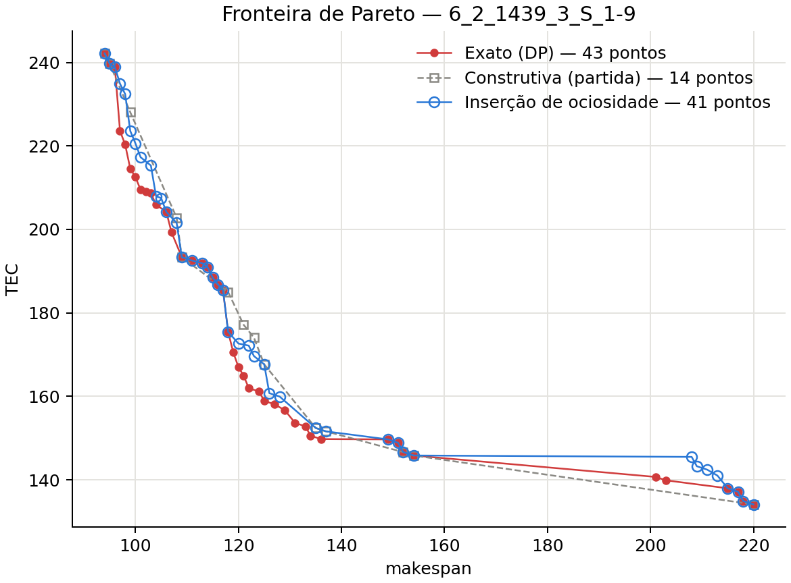

# Heurística de inserção ótima de ociosidade

Esta é uma **heurística de decomposição** do tipo *sequenciar e depois programar no tempo* (*sequencing + timing*):

- **O que fica fixo:** a alocação das tarefas às máquinas e a ordem em cada máquina, que vêm de uma solução de partida.
- **O que é otimizado:** os instantes de início, com espera voluntária, e os modos de operação. Para a sequência fixa, eles são escolhidos de forma **ótima** por programação dinâmica.

Não há regra gulosa: nenhuma decisão é tomada olhando só o passo atual, porque a programação dinâmica considera todas as combinações de início e modo da máquina inteira. Também não é uma meta-heurística, pois não tem população, iterações de busca nem aleatoriedade.

A parte heurística está em fixar a sequência. Para uma sequência fixa, a fronteira obtida é exata; os métodos exatos do repositório, além disso, também escolhem a alocação e a ordem.

## Por que esperar pode compensar

No modelo de `problem.py`, nem a espera nem o setup consomem energia. Atrasar uma tarefa que começaria dentro da ponta para depois dela troca slots caros por slots baratos, ao custo de terminar mais tarde. A heurística construtiva sempre começa as tarefas o mais cedo possível; esta heurística explora a espera que o modelo permite.

## Arquivos

| Arquivo | Conteúdo |
|---|---|
| `ociosidade.py` | programação dinâmica por máquina, combinação das máquinas, soluções de partida, JSON e linha de comando |
| `grafico.py` | fronteiras exata, de partida e após a inserção de ociosidade (formato da Fig. 9A) |
| `tests/test_heuristica_ociosidade.py` | 8 testes, na raiz do projeto |

## Como executar

```bash
python src/heuristics/ociosidade/ociosidade.py data/input/set1/6_2_1439_3_S_1-9.dat                  # partida: heurística construtiva
python src/heuristics/ociosidade/ociosidade.py <entrada> --base data/output/spea2/<entrada>.json     # partida: qualquer resultado salvo
python src/heuristics/ociosidade/ociosidade.py <entrada> --modos-fixos                              # otimiza só as esperas
python src/heuristics/ociosidade/grafico.py                                                         # gráfico comparável à Fig. 9A
python -m unittest tests.test_heuristica_ociosidade -v
```

A saída vai para `data/output/heuristica_ociosidade/<entrada>.json`, no formato comum do repositório. Cada ponto registra a sua `origem`, isto é, de qual solução de partida veio a sequência.

## Pipeline

```
soluções de partida (fronteira da heurística construtiva, ou JSON de outro método)
   │  extrai alocação + ordem de cada máquina (descarta tempos; com modos livres,
   │  sequências iguais com modos diferentes viram uma só)
   ├─ 1. DP por máquina ─── menor custo para cada limite de término e (0..H)
   ├─ 2. Combinação ─────── para cada e: TEC(e) = soma das máquinas; Cmax ≤ e
   │        └─ fronteira exata da sequência fixa
   ├─ 3. União das sequências + filtro não dominado (inteiros exatos)
   ├─ 4. Validação com evaluate_schedule
   └─ 5. JSON + gráfico
```

### 1. Programação dinâmica de uma máquina

Para uma máquina com a sequência fixa j1, …, jk:

```
f_i(t) = menor custo das tarefas 1..i, com a tarefa i terminando exatamente em t

f_i(t) = min sobre os modos o de [ custo(o, t − d_o, t) + g_{i−1}(t − d_o − setup) ]

g_i(x) = min_{t ≤ x} f_i(t)
```

- **Duração e custo:** `d_o = ceil(p / velocidade do modo o)`. `custo(o, s, t)` é a integral da potência pela tarifa em `[s, t)`, em inteiros exatos: `on · slots_na_ponta + off · slots_fora`.
- **Início:** `g_0(x) = 0`, e a primeira tarefa não tem setup.
- **A espera está no `g`.** Como `g` é o mínimo sobre todos os términos anteriores até `x`, a tarefa anterior pode terminar antes do necessário, e a folga vira espera. Por isso nenhuma regra decide quando esperar: a programação dinâmica testa todas as possibilidades.
- **Resultado:** `F(e) = g_k(e)`, o menor custo da máquina terminando até `e`.
- **Custo computacional:** O(k · H · modos) por máquina. O programa guarda o modo ótimo e o término anterior de cada estado, para reconstruir os escalonamentos depois.
- **Modos fixos:** com `--modos-fixos`, cada tarefa mantém o modo da solução de partida, e só as esperas são otimizadas. Isso isola o efeito da ociosidade.

### 2. Combinação das máquinas

Cmax é o maior término entre as máquinas, e TEC é a soma dos custos das máquinas. Para cada limite `e` de Cmax, o menor TEC possível é `Σ_m F_m(e)`. Basta varrer `e` de 0 a H e registrar cada `e` em que o TEC diminui. O resultado é a fronteira de Pareto **exata** daquela alocação e ordem.

### 3 a 5. União, validação e saída

As fronteiras de todas as sequências de partida passam pelo filtro não dominado (`insert_pareto`). Cada ponto final é revalidado por `evaluate_schedule`, com as esperas reconstruídas pela programação dinâmica.

## Resultado: fronteira de Pareto (comparável à Fig. 9A)

O gráfico mostra a instância `6_2_1439_3_S_1-9`. A fronteira exata da DP está em vermelho, a da heurística construtiva (a solução de partida) em cinza, e a da inserção de ociosidade em azul:



A heurística parte de 14 pontos da construtiva e chega a 41, dos quais 20 estão na fronteira exata (que tem 43); a construtiva acertava 6. Os dois extremos exatos são alcançados, e nenhum ponto domina a fronteira exata.

As sequências distintas da construtiva são só 3. A programação dinâmica extrai de cada uma toda a gama de escolhas de modo, e por isso a cobertura aumenta tanto.

**Set1, comparado com a fronteira exata da DP** (partida: heurística construtiva, modos livres):

| Instância | Pontos (heurística) | Pontos (exato) | Em comum (ociosidade) | Em comum (construtiva) | Menor Cmax (heur. / exato) | Tempo |
|---|---:|---:|---:|---:|---:|---:|
| `6_2_1439_3_S_1-9` | 41 | 43 | 20 | 6 | 94 / 94 | 0,07 s |
| `7_2_1439_3_S_1-9` | 40 | 41 | 10 | 2 | 125 / 124 | 0,08 s |
| `8_2_1439_3_S_1-9` | 60 | 57 | 3 | 2 | 135 / 131 | 0,12 s |
| `9_2_1439_3_S_1-9` | 87 | 86 | 21 | 1 | 152 / 151 | 0,16 s |
| `10_2_1439_3_S_1-9` | 95 | 97 | 0 | 0 | 173 / 170 | 0,23 s |

No set1, nenhum ponto usa espera. O makespan dessas instâncias fica abaixo de 1080, onde a ponta começa, e esperar só aumentaria o término. O ganho ali vem da escolha ótima de modos para cada sequência.

**Efeito da espera no set2.** Em `250_10_1439_5_S_1-9`, com modos fixos (só esperas):
- a fronteira passa de 87 para 187 pontos, e 100 deles usam espera;
- esses pontos ficam na região de Cmax alto (cerca de 1200 a 1413), onde as últimas tarefas cruzam a ponta;
- a economia de TEC em relação à construtiva com o mesmo Cmax chega a 0,96%, com média de 0,53%.

O efeito existe, mas é pequeno. O motivo é que só as tarefas que cruzam a ponta se beneficiam da espera.

**Tempo:** `250_10_1439_5_S_1-9` leva cerca de 20 s, além dos cerca de 38 s da construtiva que gera as sequências de partida. `750_20_1439_5_S_1-9` (horizonte de 2 dias) leva 246 s no total, incluindo a construtiva. Ela gera 8 sequências distintas, e a fronteira final tem 468 pontos, 42 deles com espera.

## Limitações

- **A qualidade depende da partida.** A alocação e a ordem nunca mudam; uma sequência ruim continua ruim, apenas com os melhores tempos e modos possíveis para ela.
- **Custo pseudo-polinomial no horizonte.** A programação dinâmica percorre todos os instantes de 0 a H, então horizontes longos (instâncias de vários dias) aumentam o tempo de forma proporcional.
- **Sem certificação global:** a fronteira é exata apenas para as sequências fixas (`pareto_proven: false`).

## Classificação na literatura

- **Heurística de decomposição** em duas etapas: sequenciamento e depois programação no tempo (*timing*).
- A etapa de *timing* é um problema de **inserção ótima de ociosidade** (*optimal idle time insertion*), resolvido de forma exata por programação dinâmica para a sequência dada. Esse tipo de problema aparece na literatura de escalonamento com custos que dependem do instante, como adiantamento e atraso, e tarifas por horário.
- Por usar um procedimento exato dentro de uma heurística, ela se aproxima das **mateurísticas**, mas sem resolvedor externo.

## Validação

`tests/test_heuristica_ociosidade.py` tem 8 testes. Eles verificam que:

- a programação dinâmica é ótima: numa instância mínima (3 tarefas, ponta em [10, 18), horizonte 30), ela coincide com a enumeração de todos os modos e esperas, para cada limite de término;
- todo ponto reconstruído tem esperas não negativas e coincide com `evaluate_schedule`;
- com modos fixos, o ponto de menor TEC espera a ponta passar e custa menos que o ponto sem espera;
- `--modos-fixos` preserva os modos de partida;
- a fronteira é não dominada, e cada ponto da construtiva é igualado ou dominado, já que a programação dinâmica inclui a solução sem espera;
- nenhum ponto domina a fronteira exata de `6_2_1439_3_S_1-9`;
- ler as sequências de um JSON de resultado dá o mesmo resultado que recebê-las diretamente;
- o JSON tem o formato esperado.
